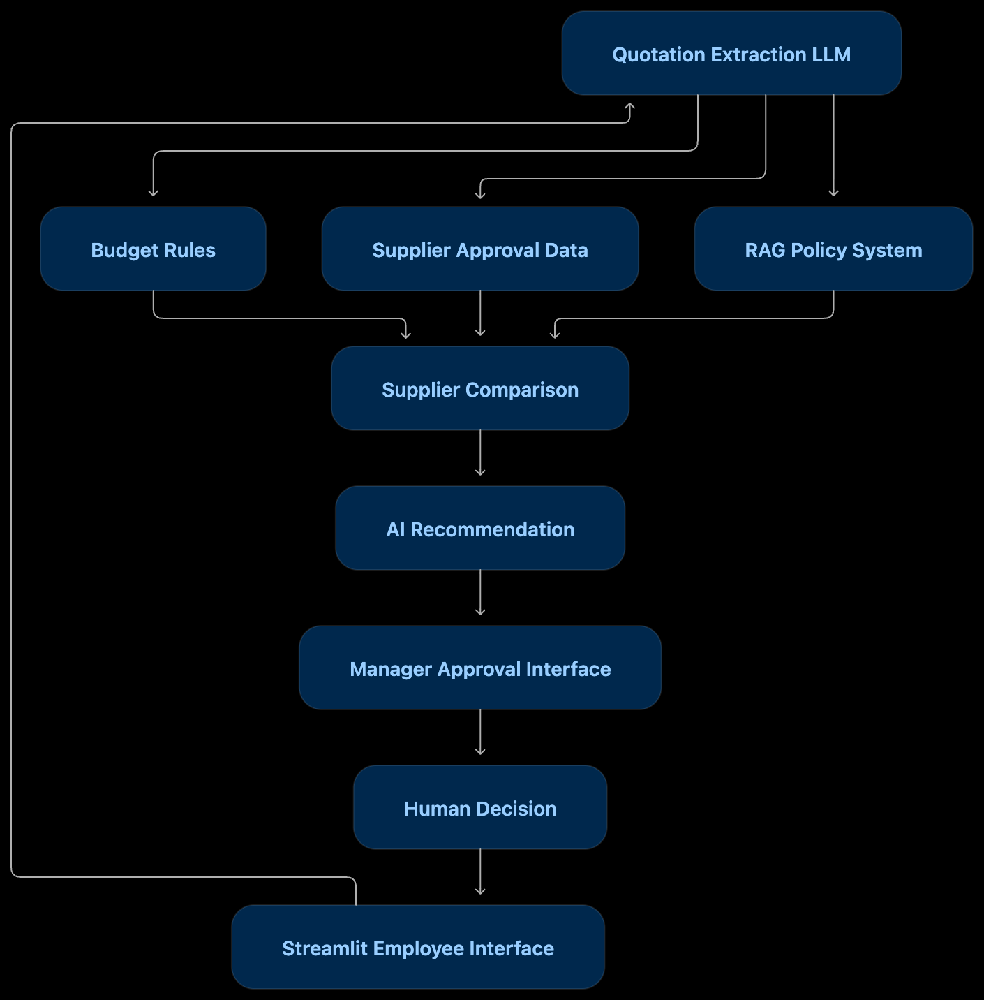

# ProcurePilot

ProcurePilot is an AI-assisted procurement system designed to evaluate supplier quotations, check company requirements, recommend the most suitable supplier, and support human approval before a procurement decision is finalized

The system combines structured AI extraction, deterministic business rules, Retrieval-Augmented Generation (RAG), supplier comparison, AI-assisted recommendation, and a human-in-the-loop approval workflow

## What is ProcurePilot?

In a typical procurement process, an employee may need to purchase equipment or services and receive quotations from several suppliers

For example:

- Department: IT
- Item: Lenovo ThinkPad
- Quantity: 30
- Maximum budget: €35,000
- Required delivery: 14 days

The employee may receive several quotation PDFs from different suppliers

Instead of manually checking every quotation, ProcurePilot analyses the suppliers automatically

The system evaluates factors such as:

- Total price
- Department budget
- Maximum allowed purchase budget
- Delivery time
- Warranty
- Supplier approval status
- Company procurement policies

After analysing the available suppliers, ProcurePilot generates a recommendation explaining which supplier is the strongest available option and what issues, if any, still need attention

A human manager remains responsible for the final approval or rejection

## What Problems Does It Solve?

Procurement decisions often require employees to manually compare multiple supplier quotations and verify different company rules

This creates several problems:

- Comparing multiple quotations manually takes time
- Important requirements can easily be missed
- The cheapest supplier is not always the best supplier
- Employees need to check whether suppliers are approved
- Procurement policies may be stored in separate documents
- Budget, delivery and policy requirements must all be considered together
- Some purchases require human approval before they can proceed

ProcurePilot reduces this manual work by automatically extracting quotation information and creating a structured comparison between suppliers

Instead of checking several PDFs and policy documents manually, the user receives a concise recommendation together with the relevant issues

## System Workflow

  

## How to Use

1. Enter the purchase request details, including department, item, quantity, maximum budget, and required delivery time
2. Upload one or more supplier quotation PDF files
3. Press `Analyse` to start the supplier evaluation
4. Review the generated supplier recommendation and identified issues
5. In the `Manager Approval` page review the purchase request, supplier comparison, and System recommendation
6. Press `Approve` to approve the request or `Reject` to reject it
7. In the main page view the updated approval status
8. Press `New Request` to clear the current request and start a new procurement process

## Demo
[Watch the ProcurePilot demo](https://www.youtube.com/watch?v=1jY60rpOLSY)
